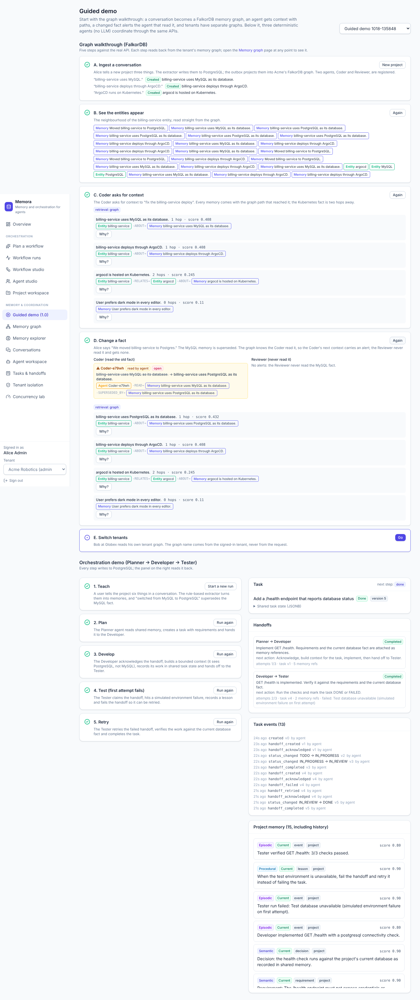
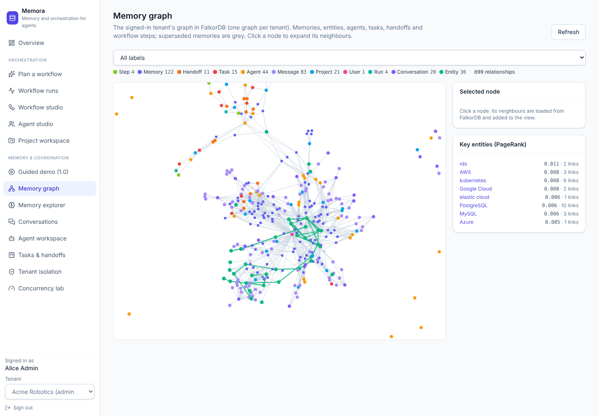
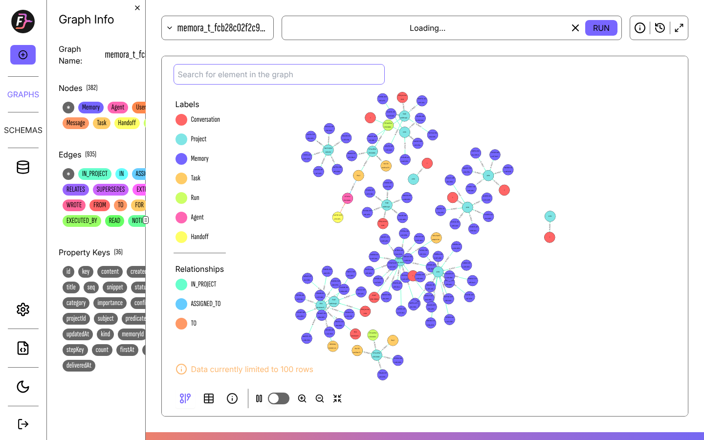
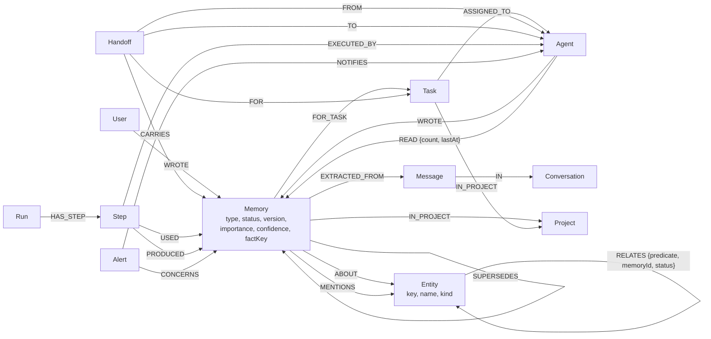

# Memora — shared graph memory for AI agents, built on FalkorDB

**Track: 02 — Agent Memory and Coordination** (WeMakeDevs × FalkorDB *Graph Hacks: Context for AI Agents*)

Memora is shared memory and coordination infrastructure for AI agents. Agents and people talk; a rule-based
extractor turns conversations into episodic, semantic and procedural memories; and every memory, entity, agent,
task, handoff and workflow step becomes part of **one FalkorDB graph per tenant**. The parts of the product that
matter read from that graph:

- **Agent working context is a graph traversal.** `POST /api/v1/context` (and the `context.build` tool used by
  workflow agents) seeds from the entities a query names, expands up to two hops through Cypher, scores by hop
  distance, importance, confidence and recency, and returns *the path* that reached every memory.
- **"Why does the agent know this?"** is a graph path: `GET /api/graph/explain` returns the shortest path from a
  task, agent or entity to a memory, plus its provenance (message, conversation, writer, superseded versions, readers).
- **Stale-knowledge alerts** are a traversal: when a fact changes, the graph finds the agents that READ the old
  version, the active runs whose steps USED it and the open handoffs that CARRY it, and the next context bundle of
  each affected agent opens with "⚠ Changed since you last read it".
- **Who-knows-what and impact analysis** are graph tools agents call inside workflows
  (`graph.who_knows`, `graph.impact`, `graph.neighbors`, `graph.explain`).
- **Key entities** are ranked with FalkorDB's `algo.pageRank` over the entity graph (`GET /api/graph/key-entities`).
- **Tenants are separate graphs** (`memora_t_<tenant>`) in one FalkorDB, chosen only from the authenticated caller.

**Demo video (2:53, 1080p):** [docs/demo/memora-demo.mp4](https://github.com/Adi-o-s/engram-graph-memory/blob/main/docs/demo/memora-demo.mp4) · **For judges:** [docs/JUDGE_BRIEF.md](docs/JUDGE_BRIEF.md)

Turn FalkorDB off and context assembly, explanations, alerts and the graph tools stop working: the graph is the
read path, not a viewer on top of SQL.

Memora also orchestrates multi-agent workflows (config-defined agents, workflow graphs, durable execution,
approvals): see [docs/ORCHESTRATION_ARCHITECTURE.md](docs/ORCHESTRATION_ARCHITECTURE.md).

**Zero cost.** Memora runs entirely on your machine. It calls no model API, needs no API key, cloud
account or credit card, and every runtime dependency is open source. See
[docs/COST_AND_DEPENDENCY_AUDIT.md](docs/COST_AND_DEPENDENCY_AUDIT.md).

## Track 02 on the graph

| Track 02 asks for | In Memora | Tested by |
|---|---|---|
| Episodic, semantic and procedural memory | `(:Memory {type})` nodes linked to `(:Entity)` by `ABOUT`/`MENTIONS`; facts are also `RELATES` edges between entities, so they chain across hops | `GraphMemoryIT.graphRetrievalFindsATwoHopFactThatKeywordSearchMisses` |
| Persistent conversation history | `(Memory)-[:EXTRACTED_FROM]->(Message)-[:IN]->(Conversation)`; FalkorDB data on a named volume with AOF | `GraphRestartIT`, `GraphMemoryIT` (explain provenance) |
| Shared state and handoffs between agents | `(Handoff)-[:FROM/TO]->(Agent)`, `-[:FOR]->(Task)`, `-[:CARRIES]->(Memory)`; `(Agent)-[:READ]->(Memory)`; stale-knowledge alerts | `GraphMemoryIT.anAgentThatReadAChangedFactIsWarnedAndOneThatDidNotIsNot` |
| High-concurrency reads and writes | PostgreSQL takes the concurrent writes (advisory locks, unique indexes); the projector drains the outbox with `FOR UPDATE SKIP LOCKED`, idempotent `UNWIND … MERGE` batches | `ConcurrentWritesIT`, `TaskConcurrencyIT`, `ProjectorThroughputIT`, `GraphMemoryIT.aMemoryWrittenInPostgresIsProjectedAndReplayIsIdempotent` |
| Separate memory per user or tenant | One graph per tenant; personal (USER-scoped) memories filtered in every Cypher query and re-checked in PostgreSQL | `GraphMemoryIT.tenantsHaveSeparateGraphsAndForgedIdsFindNothing`, `TenantIsolationIT` |
| Remember across sessions | Graph persists across FalkorDB restarts and can be rebuilt from PostgreSQL at any time | `GraphRestartIT`, `GraphMemoryIT.rebuildReconstructsTheSameGraphFromPostgres` |
| Show the path behind an answer | Every context memory carries its graph path; `/api/graph/explain` | `GraphMemoryIT`, `e2e/graph.spec.ts` |

## Measured results

Every number here comes from a test in this repo; the commands, the full tables and what was not verified are in
[docs/TEST_RESULTS.md](docs/TEST_RESULTS.md#falkordb-graph-memory-run-on-2026-10-18).

- **Tests:** 145 backend tests (JUnit 5, real PostgreSQL and FalkorDB), 15 Vitest tests and 12 Playwright browser
  tests pass.
- **Retrieval eval** (`RetrievalEvalIT`, a synthetic project of 12 services, each query with 3 direct and 3
  two-hop relevant facts): recall@6 is **0.97 for graph retrieval and 0.50 for keyword retrieval**; at k=10 graph
  reaches 1.00 and keyword stays at 0.50, because keyword search never finds the two-hop facts. Graph context is
  slower than keyword context in the same run. The first run of this eval found a scoring bug (graph recall@6
  0.22), which is described in the results doc.
- **Projector** (`ProjectorThroughputIT`, 400 memories from 8 concurrent writers): the graph was at most about
  1.5 s behind PostgreSQL during the burst, the outbox was empty 237 ms after the last write, and no row failed.

## See it



The **Guided demo** opens with a five-step graph walkthrough: ingest a conversation, see the entities appear, get
agent context with paths (one fact two hops away), change a fact and see the alert reach only the agent that read
it, and compare the Acme and Globex graphs. **Memory graph** shows the tenant graph and its PageRank key entities.



The same Acme graph in FalkorDB Browser, which `docker compose up` starts next to the database:



## Graph data model

One graph per tenant, so there is no tenant node. Every node has `id` (entities: `key`) and `createdAt`.



Facts are stored twice on purpose: as a `Memory` node (content, provenance, versions) and as an
`(Entity)-[:RELATES]->(Entity)` edge, which is what lets "billing-service uses Postgres" and "Postgres is hosted
on RDS" chain into a two-hop answer about billing-service. Entity keys are canonical (`Postgres`, `PostgreSQL`
and `postgres` are all `postgresql`, via `TechVocabulary`). Indexes: exact-match on `id` for every label and on
`Entity.key`, full-text on `Memory.content`. Every Cypher statement is listed, verbatim, in
[docs/GRAPH_QUERIES.md](docs/GRAPH_QUERIES.md).

## Why two databases

PostgreSQL stays the transactional system of record: users, auth, row-level security, task versions, handoff
leases, workflow runs. It is what guarantees that two agents cannot both own a task and that a fact has exactly one
current version. FalkorDB is where memory is **connected, traversed and explained**: context retrieval, explain
paths, stale-knowledge alerts and the agent graph tools all read from it.

They are joined by a **transactional outbox**. Database triggers (`V5__graph_outbox.sql`) add a `graph_outbox` row
in the same transaction that writes a memory, task, handoff, message, run or step; agent reads are added by the
service that served them. The `GraphProjector` claims rows with `SELECT … FOR UPDATE SKIP LOCKED`, re-reads current
state and applies idempotent `UNWIND … MERGE` batches, retrying failed rows with exponential backoff. Before a
traversal, the reader applies its tenant's pending rows (read-your-writes). `POST /api/admin/graph/rebuild` deletes
a tenant's graph and rebuilds it from PostgreSQL, so the graph can always be reconstructed. Ids the graph returns
are re-checked against PostgreSQL (RLS and personal scope) before anything reaches a client.

| | |
|---|---|
| Backend | Java 21, Spring Boot 3.5, Spring Security (JWT + agent API keys), JPA, Flyway, PostgreSQL 16, FalkorDB 4.14 (JFalkorDB 0.14) |
| Dashboard | React 19, TypeScript, Vite, Tailwind CSS 4, React Router, Recharts, react-force-graph-2d |
| Ops | Docker Compose, Maven Wrapper, npm lockfile |
| Tests | 145 backend tests (JUnit 5, real PostgreSQL and FalkorDB), 15 Vitest tests, 12 Playwright browser tests, HTTP load test |

## Quick start (Docker)

```bash
cp .env.example .env
# edit .env: set POSTGRES_SUPERUSER_PASSWORD, MEMORA_DB_PASSWORD and MEMORA_JWT_SECRET
#   (for example: openssl rand -base64 48)
docker compose up --build
```

> Nothing is hosted online. These `localhost` links only open on the machine where `docker compose up` is running.

- Dashboard: http://localhost:3000
- FalkorDB Browser: http://localhost:3001 (host `falkordb` from inside Compose, or `localhost`, port 6379; graphs are named `memora_t_<tenant id>`)
- API: http://localhost:8080 · Swagger UI: http://localhost:8080/swagger-ui.html · Health: http://localhost:8080/actuator/health

Sign in with a demo account (password `memora-demo`):

| Account | Tenant | Role |
|---|---|---|
| alice@acme.test | Acme Robotics | admin |
| aaron@acme.test | Acme Robotics | member (sees only their own conversations) |
| bob@globex.test | Globex Health | admin |
| casey@consultant.test | both | member, switches tenants |

Then open **Guided demo** and click **Go** on steps A–E of the graph walkthrough.
[docs/DEMO_VIDEO_SCRIPT.md](docs/DEMO_VIDEO_SCRIPT.md) is a 3-minute presenter script for it;
[docs/DEMO_SCRIPT.md](docs/DEMO_SCRIPT.md) covers the rest of the dashboard.

Port clash? If host port 3001 is already used (for example you run the dashboard on 3001 with
`MEMORA_UI_PORT=3001`), set `MEMORA_FALKORDB_BROWSER_PORT=3002` in `.env`.

## Run without Docker

Needs JDK 21, Node 20+, PostgreSQL 15+ (16 recommended) and FalkorDB (the easiest way is still its container).

```bash
sudo -u postgres scripts/setup-local-db.sh        # once: creates role memora/memora, DBs memora + memora_test
docker run -d --name memora-falkordb -p 6379:6379 -p 3001:3000 -v memora-falkordb:/var/lib/falkordb/data \
  -e REDIS_ARGS="--appendonly yes" falkordb/falkordb:v4.14.6

cd backend
MEMORA_JWT_SECRET=$(openssl rand -base64 48) ./mvnw spring-boot:run   # http://localhost:8080

cd ../frontend
npm ci
npm run dev                                       # http://localhost:5173 (proxies /api to :8080)
```

Full instructions, every environment variable and troubleshooting: [docs/SETUP_GUIDE.md](docs/SETUP_GUIDE.md).

## Tests

```bash
cd backend && ./mvnw test        # needs Docker (Testcontainers), or point it at running services:
#   MEMORA_TEST_DB_URL=jdbc:postgresql://localhost:5432/memora_test MEMORA_TEST_FALKORDB_URL=redis://localhost:6379
#   (GraphRestartIT restarts FalkorDB: it runs with Testcontainers, or with MEMORA_TEST_FALKORDB_CONTAINER=<container name>)
cd frontend && npm test          # Vitest unit and component tests
cd frontend && npm run build && npm run preview &   # then, with the backend running:
cd frontend && npm run e2e       # Playwright drives the real dashboard against the real API
java load-test/LoadTest.java http://localhost:8080 32 50   # HTTP load test; prints measured percentiles
```

The backend suite wipes and re-migrates its test database, so never point `MEMORA_TEST_DB_URL` at real data.
Results from the last full run, and known limitations: [docs/TEST_RESULTS.md](docs/TEST_RESULTS.md).

## Reset

```bash
scripts/reset-db.sh docker   # Docker: deletes the volume and starts fresh with demo data
scripts/reset-db.sh local    # local PostgreSQL: drops and recreates the memora database
```

## Orchestration in two minutes

Sign in, open **Plan a workflow**, pick **E-commerce website**, click **Propose a workflow**, then **Save and run
now**. Watch the run's graph (parallel steps, a skipped conditional step, a QA loop that closes a real coverage gap),
inspect any step, approve the handover, and open the artifacts. Then run **Research and report** in the project
*Search engine evaluation* to see different agents on the same engine.

What is and is not intelligent here: agents are **configurations** executed by a deterministic template executor
(tool calls over memory, artifacts and checks) or by an **external** agent through its inbox. Memora calls no
model. The software-delivery agents produce requirements, contracts, a design spec, a schema scaffold, plans and
verification reports, not working application code; assign implementation steps to an external agent for that.

## Documentation

- [docs/JUDGE_BRIEF.md](docs/JUDGE_BRIEF.md): one page for judges, what to look at and where
- [docs/GRAPH_QUERIES.md](docs/GRAPH_QUERIES.md): every Cypher statement, verbatim, and what it is for
- [docs/DEMO_VIDEO_SCRIPT.md](docs/DEMO_VIDEO_SCRIPT.md): the 3-minute graph demo

- [docs/ORCHESTRATION_AUDIT.md](docs/ORCHESTRATION_AUDIT.md): what Memora 1.0 could and could not do, and the plan
- [docs/ORCHESTRATION_ARCHITECTURE.md](docs/ORCHESTRATION_ARCHITECTURE.md): engine, data model, guarantees, API
- [docs/AGENT_DEFINITIONS.md](docs/AGENT_DEFINITIONS.md): configurable agents, memory scopes, executors, templates
- [docs/WORKFLOW_BUILDER.md](docs/WORKFLOW_BUILDER.md): workflow specs, validation, running
- [docs/TOOL_SECURITY.md](docs/TOOL_SECURITY.md): tool authorisation, isolation, secrets
- [docs/ORCHESTRATION_DEMO.md](docs/ORCHESTRATION_DEMO.md): the 8-minute orchestration demo

- [docs/ARCHITECTURE.md](docs/ARCHITECTURE.md): modules, data model, isolation, concurrency, API
- [docs/SETUP_GUIDE.md](docs/SETUP_GUIDE.md): installation, configuration, troubleshooting
- [docs/DEPLOY_VERCEL.md](docs/DEPLOY_VERCEL.md): dashboard on Vercel, backend on a server with HTTPS
- [docs/DEMO_SCRIPT.md](docs/DEMO_SCRIPT.md): a 5-minute hackathon walkthrough
- [docs/TEST_RESULTS.md](docs/TEST_RESULTS.md): what was run, actual results, known limitations
- [docs/REQUIREMENTS_FROM_USER.md](docs/REQUIREMENTS_FROM_USER.md): what you need to provide (and what you don't)
- [docs/COST_AND_DEPENDENCY_AUDIT.md](docs/COST_AND_DEPENDENCY_AUDIT.md): licences, costs, zero-cost hosting options
- [TASKS.md](TASKS.md): progress tracker

## Using the API from an agent

```bash
# An admin registers an agent; the key is shown once (only its hash is stored).
TOKEN=$(curl -s localhost:8080/api/v1/auth/login -H 'Content-Type: application/json' \
  -d '{"email":"alice@acme.test","password":"memora-demo"}' | jq -r .token)
KEY=$(curl -s localhost:8080/api/v1/agents -H "Authorization: Bearer $TOKEN" -H 'Content-Type: application/json' \
  -d '{"name":"Reviewer","role":"CUSTOM","capabilities":["review"]}' | jq -r .apiKey)

# The agent writes and reads shared memory with its own key.
curl -s localhost:8080/api/v1/memories -H "X-Agent-Key: $KEY" -H 'Content-Type: application/json' \
  -d '{"type":"SEMANTIC","content":"The project deploys on Thursdays.","subject":"project","predicate":"deploy.day","value":"thursday"}'
curl -s -X POST localhost:8080/api/v1/context -H "X-Agent-Key: $KEY" -H 'Content-Type: application/json' \
  -d '{"query":"deploy","maxChars":2000}' | jq -r .rendered
```

## Your own agent flow

The guided demo's agents are built in. To run a flow with an agent you registered yourself, see
[scripts/reviewer-flow.sh](scripts/reviewer-flow.sh): a Developer hands a task to a custom "Reviewer" agent,
which acknowledges it with its own key, reads context, records findings and hands the task back. Each step is one
API call, so it doubles as a template. Run it with `REVIEWER_KEY=mem_... scripts/reviewer-flow.sh` (add `STEP=1`
to pause after each step), then watch the result in Tasks & handoffs.

## AI disclosure

This project was built with heavy use of AI. Claude (through Claude Code) wrote a large share of the code, tests
and documentation, including the FalkorDB integration, the dashboard graph features, the evaluations and this
README, working from the team's written specifications. The team set the goals, constraints and acceptance
criteria (zero cost, tenant isolation, "never fabricate" numbers), chose the architecture, ran the builds and the
app on their own machines, reviewed the pull requests and decided what to merge.

Team: Adi ([@Adi-o-s](https://github.com/Adi-o-s)).
